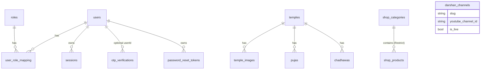

# Database and Data Models

Source: `backend/prisma/schema/{auth,temple,shop,darshan,schema}.prisma`, 5 migrations in `backend/prisma/migrations/`. Provider: PostgreSQL via Prisma 7 (`provider = "prisma-client-js"`, `@prisma/adapter-pg`, `DATABASE_URL`). Migrations and seeds were **not run**; table list is from migration SQL (13 `CREATE TABLE`, 2 enums).

## 1. MongoDB — correction to the assumption of "separate MongoDB usage"

**No MongoDB code exists in the repository** (no `mongo` string in `backend/src`, `backend/prisma`, `backend/package.json`, or `frontend/src`). Only leftover environment keys `MONGODB_URI`, `MONGODB_DNS_SERVERS` and `DARSHAN_REFRESH_INTERVAL_MINUTES` appear in a local, untracked `backend/.env` (names only inspected). The git history message "changed polling to SSE and removed mongodb" is consistent with a past removal. Live Darshan state is in PostgreSQL (`darshan_channels`). Whether any MongoDB instance still exists in production is **[UNKNOWN]**.

## 2. Entity-relationship diagram (from schema evidence)

`darshan_channels` is deliberately unrelated to `temples` (comment in `darshan.prisma`: slugs don't line up 1:1; different required fields).

## 3. Models

### Auth (`auth.prisma`)

| Model → table | Key fields | Constraints / indexes |
|---|---|---|
| `User` → `users` | `id` cuid; `email` unique; `password?`; `phoneNo?` unique; `googleId?` unique; `authProvider` LOCAL/GOOGLE (default LOCAL); `firstName,lastName,gender,address,state,country,city,dateOfBirth,profileImage,profileImagePublicId`; flags `profileCompleted`(default false) `isEmailVerified` `isPhoneVerified` `isActive`(true) `isDeleted`(false); `deletedAt`; timestamps | `@@index([email])`, `@@index([isActive])` |
| `OtpVerification` → `otp_verifications` | `email`, `otpCode` (SHA-256 hex), `type` REGISTER/LOGIN, `used`, `userId?` (cascade), `expiresAt` | index email, expiresAt |
| `PasswordResetToken` → `password_reset_tokens` | `userId`, `token` unique (**plaintext**), `used`, `expiresAt` | index userId, token |
| `Role` → `roles` | `name` unique (USER, ADMIN, SUPERADMIN seeded) | |
| `UserRoleMapping` → `user_role_mapping` | `userId`, `roleId`, `assignedAt`, `assignedBy?` | unique(userId, roleId); indexes |
| `Session` → `sessions` | `refreshToken` (SHA-256 hex), `device?`, `userId`, `expiresAt` | index userId, expiresAt; **no index on refreshToken** |

Unused/unsurfaced fields: `gender`, `address`, `profileImage*` (no code writes them except Google profile image on link/create); no delete/deactivate API sets `isDeleted/isActive/deletedAt`.

### Puja / Chadhawa (`temple.prisma`)

| Model → table | Key fields | Notes |
|---|---|---|
| `Temple` → `temples` | `slug` unique, `name,location,state,deity,description`, `priceFrom` Int, `gradient?` | index name, state; `priceFrom` is manually set — not derived from `pujas.price` |
| `TempleImage` → `temple_images` | `templeId` (cascade), `url`, `publicId` (Cloudinary) | |
| `Puja` → `pujas` | `templeId` (cascade), `name`, `price` Int, `duration` String, `benefits String[]` | |
| `Chadhawa` → `chadhawas` | `templeId` (cascade), `name`, `description`, `price` Int, `emoji?`, `isActive`(true), `displayOrder`(0) | indexes templeId, (templeId,isActive), displayOrder; name uniqueness per temple enforced **in application only** |

### Shop (`shop.prisma`)

| Model → table | Key fields | Notes |
|---|---|---|
| `ShopCategory` → `shop_categories` | `name` unique, `slug` unique, `description?`, `image?`, `imagePublicId?`, `isActive` | |
| `ShopProduct` → `shop_products` | `categoryId` (**onDelete: Restrict**), `name`, `slug` unique, `price`, `originalPrice?`, `description`, `benefits String[]`, `authenticity`, `gradient?`, `image?`, `imagePublicId?`, `isActive` | indexes category, isActive, createdAt, (categoryId,isActive) |

### Live Darshan (`darshan.prisma`)

`DarshanChannel` → `darshan_channels`: `slug` unique, `name`, `youtubeChannelId` (default `""`), `currentLiveVideoId?`, `isLive`, `lastCheckedAt?`; indexes youtubeChannelId, isLive.

### Absent (documented so nobody assumes them)

No Order, Booking, Cart, CartItem, Payment, Address, Inventory/Stock, Donation, Prayer, Reminder/Subscription, ContactMessage, NewsletterSubscriber, Reading/ChatHistory, UserProfile-extension, or Audit tables exist.

## 4. Data creation and update flows

| Flow | Writes |
|---|---|
| Register | `users` + `user_role_mapping` (transaction); or update of unverified user |
| Email OTP | `otp_verifications` insert / mark used; `users.isEmailVerified` |
| Phone verify | `users.isPhoneVerified` |
| Login/Google/refresh | `sessions` insert/delete; Google link updates `users.googleId,isEmailVerified,profileImage` |
| Password reset | `password_reset_tokens` insert/used; `users.password` (transaction) |
| Admin CMS | CRUD on temples/images/pujas/chadhawas/shop tables; Cloudinary assets in parallel (non-atomic) |
| Darshan | upsert from `temples.json` via seed; `markLive/markOffline/touchLastChecked` from webhook and poll |
| Readings / AI chats / karma | **no database writes** (browser localStorage only) |

## 5. Ownership by module

Auth → users, roles, user_role_mapping, sessions, otp_verifications, password_reset_tokens · Puja → temples, temple_images, pujas · Chadhawa → chadhawas (reads temples) · Shop → shop_categories, shop_products · Darshan → darshan_channels · Admin → no tables (re-reads users/roles).

## 6. Persistence vs in-memory / mock

* Persistent: tables above.
* In-process memory: Darshan `EventEmitter` listeners, WebSub/poll timers.
* Browser only: session tokens, all Inner Voice data, Darshan prayer wall (component state), cart quantities (component state).
* Mock/hard-coded: `data/liveStreams.ts`, `data/blogPosts.ts`, zodiac/tarot data, fallbacks.

## 7. Seeds and migrations

| Item | Notes |
|---|---|
| `npm run db:migrate` (`prisma migrate dev`) / `db:deploy` (`migrate deploy`) | not run |
| `db:seed` (`prisma/seeds/index.ts`) | upserts roles USER/ADMIN/SUPERADMIN — **required before registration works** |
| `db:seed:puja`, `:chadhawa`, `:shop`, `:darshan` | catalogue data and Darshan channels (from `temples.json`) — contents not audited |
| `prisma/seeds/makeadmin.ts` | promotes a **hard-coded personal email** to ADMIN; imports `../../prisma` without `.js` (differs from other seeds) — not parameterised |
| Migration drift | migration dir names are dated 2026-08…2026-10; whether prod DB matches is **[UNKNOWN]** |

## 8. Consistency risks

* `Temple.priceFrom` vs puja prices can drift.
* Cloudinary and DB updates are not atomic (compensation only on batch upload failure; temple delete proceeds even if remote deletes fail → orphaned assets reported).
* Unique checks done as read-then-write (slugs, chadhawa names) can race; DB unique errors may surface as 500 [not verified].
* Three overlapping slug sets: `temples.json` (18), frontend `liveStreams.ts` (17 temples + 3 family events), catalogue `temples` table (admin-defined).
* No cleanup for expired OTPs, reset tokens, sessions or abandoned unverified users.
* Unverified accounts reserve emails/phones (phone unique) indefinitely.

## 9. Possible consolidation — recommendation only (nothing done)

Add Order/Booking/Payment models once commerce is specified; store chat/readings per user if product wants history; derive `priceFrom` from pujas or drop it; add purge jobs and an index on `sessions.refresh_token`; decide whether Darshan channels should link to catalogue temples. Decisions pending: [PRODUCT_DECISIONS_AND_OPEN_QUESTIONS.md](PRODUCT_DECISIONS_AND_OPEN_QUESTIONS.md).
