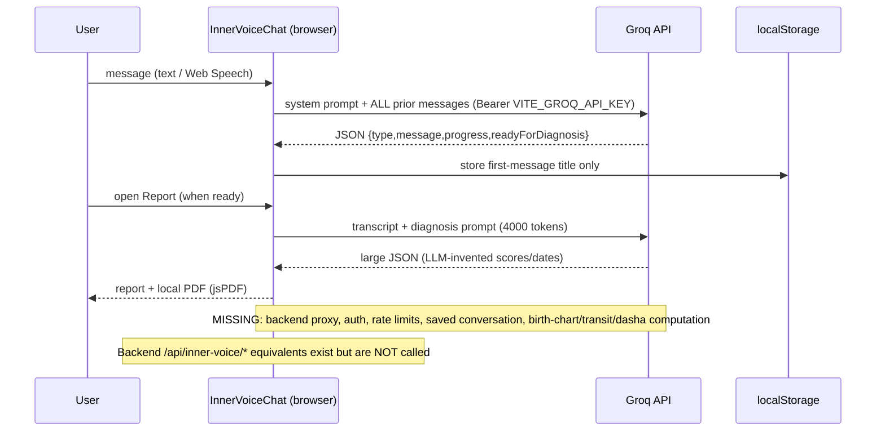
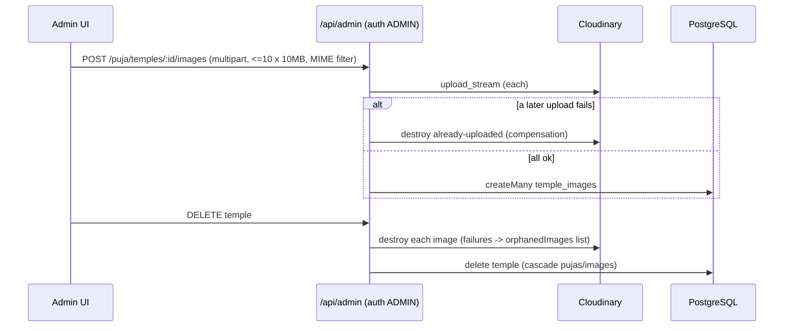
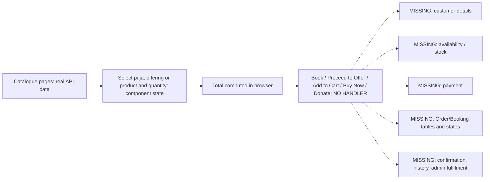
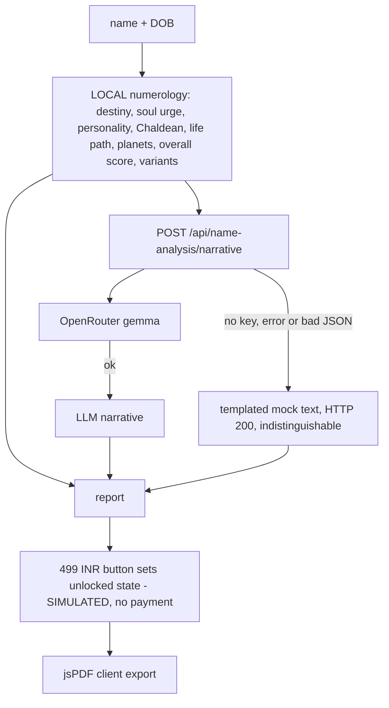

# Integration and Data Flow Diagrams

Each diagram shows what the code **actually does**. Elements drawn with dashed borders / labelled *MISSING* or *SIMULATED* are not implemented or are faked. No flow was run end-to-end. Logic detail: [FEATURE_LOGIC_REFERENCE.md](FEATURE_LOGIC_REFERENCE.md).

## 1. Registration, OTP verification, login (A1–A4, A7)

```mermaid
sequenceDiagram
  participant U as Browser
  participant B as /api/auth
  participant DB as PostgreSQL
  participant R as Resend
  participant M as MSG91
  U->>B: POST /register
  B->>DB: create user+role (txn) OR overwrite unverified user
  B-->>U: 201 (NO email/OTP sent here)
  alt choose email
    U->>B: POST /resend-otp {REGISTER}
    B->>DB: insert hashed OTP (10 min)
    B->>R: send (failures swallowed)
    U->>B: POST /verify-otp  (no attempt limit)
    B->>DB: mark used; isEmailVerified
  else choose phone
    U->>M: widget OTP
    U->>B: POST /verify-phone {email, accessToken}
    B->>M: verifyAccessToken
    Note over B: mobile match skipped if provider returns none
    B->>DB: isPhoneVerified
  end
  B-->>U: user + accessToken(1d) + refreshToken(30d)
  Note over U,B: Login: wrong/unknown email -> 404/401; unverified -> LOGIN OTP emailed (requiresVerification)
  U->>B: POST /refresh (on 401)
  B->>DB: delete old session, create new (rotation)
```

## 2. AI Guru chat (C1, C2)



## 3. Text-to-speech (C3, C8)

```mermaid
sequenceDiagram
  participant FE as VoiceConsultation / InnerVoiceChat
  participant API as POST /api/tts
  participant S as Sarvam API
  FE->>API: {text, language}
  API->>API: text.slice(0,500); en* -> en-IN else hi-IN
  API->>S: bulbul:v3, speaker manan, pace 0.85, 22050 Hz (api-subscription-key)
  S-->>API: audios[0] (base64)
  API-->>FE: {audio}
  FE->>FE: atob -> Blob(audio/wav) -> Audio.play()
  Note over API: No auth, no caching of audio, no quota handling beyond HTTP error (502/500)
```

## 4. Horoscope / astrology request flows (B1, B3, B5, B7)

```mermaid
flowchart TD
  subgraph B1["B1 Daily horoscope - LLM"]
    s1["select sign"] --> r1["GET /api/interpretation/horoscope/:sign"] --> o1["OpenRouter gpt-4-turbo-preview"] --> t1["free text - not cached - date not in prompt"]
  end
  subgraph B3["B3 Birth chart - mostly local"]
    f["name + DOB, optional time and place"] --> L["LOCAL: sun-sign table, digit-sum life path, hash pseudo-scores"]
    f --> a["POST /api/birthchart/analyze with name, zodiac, lifePath, dob, city"] --> o3["OpenRouter gemma"] --> txt["LLM text"]
    f -.->|"birth time and coordinates never sent"| X["MISSING: ephemeris, houses, planets, ascendant"]
    L --> w["fixed 5.6 s wait"] --> res["results"]
    txt --> res
  end
  subgraph B5["B5 Compatibility - simulated"]
    p["two names + DOBs"] --> h["hash pseudo-scores - sign and life path unused"] --> w5["5.6 s wait"] --> r5["results"]
    q["chat question"] --> c["keyword canned reply after 900 ms"]
    p -.->|"call commented out"| API5["POST /api/compatibility/analyze"]
  end
  subgraph B7["B7 Tarot"]
    d["client shuffle and pick cards"] --> t7["POST /api/tarot/reading"] --> o7["OpenRouter gemma-3"] --> r7["reading"]
    t7 -.->|"any failure"| fb["static fallback reading"]
  end
```



## 5. Live Darshan discovery and status updates (E1–E4)

```mermaid
sequenceDiagram
  participant YT as YouTube channel
  participant Hub as WebSub hub
  participant API as Express /api/darshan
  participant YD as YouTube Data API
  participant DB as darshan_channels
  participant FE as Browser (React Query)
  API->>Hub: subscribe (startup + every 3 days; lease 4 d)
  Hub-->>API: GET callback?hub.challenge (echoed)
  YT->>Hub: video published/updated
  Hub->>API: POST Atom XML (UNSIGNED)
  API-->>Hub: 204
  API->>YD: videos.list(videoId)
  alt live and embeddable
    API->>DB: markLive(videoId)
  else anything else
    API->>DB: markOffline  (also hit by unrelated uploads!)
  end
  API-->>FE: SSE push (EventEmitter, single process)
  FE->>FE: patch query cache -> IFrame player
  loop every 120 s
    API->>YD: videos.list(currentLiveVideoId) for live channels
    API->>DB: markOffline if ended
  end
  Note over API: MISSING: initial live scan, signature check, quota backoff, multi-instance support, FE resync after reconnect
  Note over FE: List page shows hard-coded isLive until API data arrives
```

## 6. Admin content and image upload (D8–D11)



## 7. Commerce flows - where they stop (D2, D4, D6, E6)



## 8. Name Destiny report (B6, B6b)


