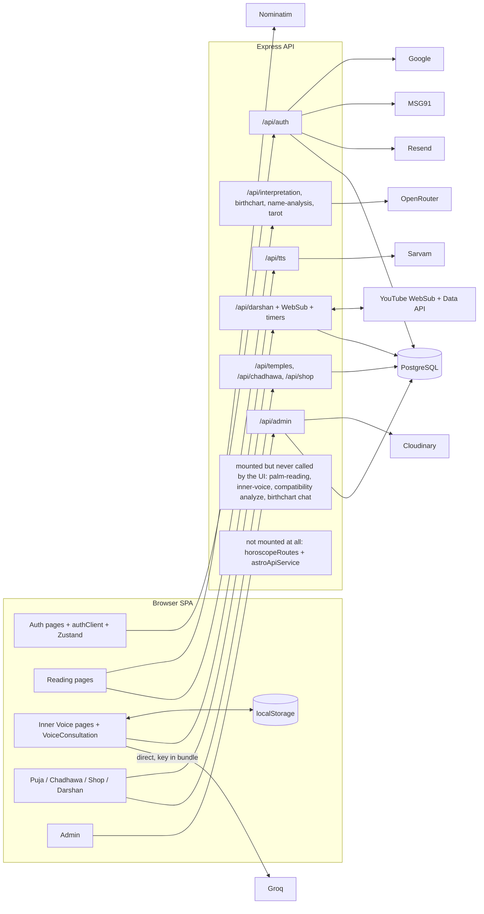

# Project Architecture

Back to [README](README.md). Related: [BACKEND_API_REFERENCE.md](BACKEND_API_REFERENCE.md), [DATABASE_AND_DATA_MODELS.md](DATABASE_AND_DATA_MODELS.md), [INTEGRATIONS_AND_ENVIRONMENT.md](INTEGRATIONS_AND_ENVIRONMENT.md).

## 1. Repository layout

```
Avatar-Astro/
├─ backend/                 Express + Prisma API
│  ├─ src/index.ts          entry point; also holds inline routes (zodiac, newsletter, contact, tts, tarot, palm)
│  ├─ src/modules/          auth, admin, puja, chadhawa, shop, darshan  (controller/route/service/validators/types)
│  ├─ src/routes/           birthChart, compatibility, nameAnalysis, innerVoice, interpretation, horoscope(unmounted)
│  ├─ src/services/         chatgptService (OpenRouter), astroApiService (dead)
│  ├─ src/controllers/      chartChat, horoscope(dead), interpretation
│  ├─ src/middleware/       authMiddleware (active), auth (legacy/dead), upload, errorHandler, birthDataValidation (dead)
│  ├─ src/utils/            mailer (Resend), msg91, googleAuth, auth (bcrypt), ApiError, responseUtils
│  ├─ src/config/           cloudinary.ts, environment.ts (legacy), temples.json (Darshan channels)
│  ├─ prisma/schema/*.prisma, prisma/migrations (5), prisma/seeds/*
│  └─ src/__tests__/        2 Jest files for dead code (cannot run)
├─ frontend/                Vite SPA
│  ├─ src/App.tsx, main.tsx
│  ├─ src/pages/            reading pages, Inner Voice, Puja/Chadhawa/Shop, AvatarLive
│  ├─ src/features/         auth, admin, puja, chadhawa, shop (api/hooks/types)
│  ├─ src/components/       UI kit (shadcn), ai-guru, NameDestinyReport, three, palm, tarot, auth
│  ├─ src/lib/              api.ts (mostly legacy), authClient.ts, numerology.ts, palmAnalysis/
│  ├─ src/store/authStore.ts, src/hooks/, src/data/ (static content), src/routes/ (guards)
│  ├─ api/tts.ts            Vercel serverless TTS copy
│  └─ public/               assets + stray copy of solar-system files
├─ solar-system-app/        separate third-party-authored Express static app with Auth0 config (iframe target)
├─ api/tts.ts               root TTS serverless copy (differs from frontend/api/tts.ts)
└─ *.md, video.txt          root status docs (unverified), stray artefacts
```

## 2. Technologies and responsibilities

| Technology | Responsibility |
|---|---|
| React + react-router | SPA, client routing, lazy-loaded auth/admin/devotion pages |
| TanStack Query | Server state for catalogues, Darshan, admin; Darshan cache patched by SSE |
| Zustand (`persist`, key `auth`) | Session (user, access/refresh tokens) in localStorage |
| react-hook-form + zod | Auth forms |
| Express | HTTP API, CORS, JSON body (20 MB), error envelope |
| Prisma + PostgreSQL | All persistent data (13 tables) |
| Joi | Validation in auth/puja/chadhawa/shop modules only |
| axios / fetch | Provider calls (OpenRouter, Sarvam, MSG91, YouTube, WebSub hub) |
| multer + Cloudinary SDK | Admin image upload (memory storage → Cloudinary) |

## 3. Entry points

* Backend: `backend/src/index.ts` → mounts routers, starts `startDarshanRefreshLoop()` then `app.listen(PORT)`. Dev: `tsx watch`; prod: `tsc && tsc-alias` → `node dist/src/index.js`. `PORT` defaults to 5001 in `index.ts` if unset (local `.env` sets 5000).
* Frontend: `frontend/src/main.tsx` → `App.tsx`. Dev server port 8081 with `/api` proxy to `localhost:5000` (`vite.config.ts`).
* Default API base in the frontend: `VITE_API_URL` or `http://localhost:5000/api`.

## 4. Routing architecture

* **Frontend:** `App.tsx` defines three route groups: (1) standalone — `/solar-system`, auth pages (`PublicRoute`), `/google-onboarding` (`GoogleOnboardingRoute`), `/admin/*` (`AdminRoute`); (2) a catch-all `*` that wraps `AnimatedRoutes` in `CosmicBackground` + `Layout`. Full inventory: [FRONTEND_REFERENCE.md](FRONTEND_REFERENCE.md).
* **Backend:** path prefixes `/api/auth`, `/api/admin`, `/api/temples`, `/api/chadhawa`, `/api/shop`, `/api/interpretation`, `/api/compatibility`, `/api/birthchart`, `/api/name-analysis`, `/api/inner-voice`, `/api/darshan`, plus inline `/api/health`, `/api/zodiac/*`, `/api/newsletter/subscribe`, `/api/contact/send`, `/api/tts`, `/api/tarot/reading`, `/api/palm-reading`. Details and mounted-vs-dead status: [BACKEND_API_REFERENCE.md](BACKEND_API_REFERENCE.md).

## 5. Authentication architecture (summary)

Access JWT (`{id, role}`, 1 d) + opaque refresh token (SHA-256 hashed in `sessions`, 30 d, rotated on use). Client attaches Bearer, deduplicates a single refresh on 401. Role hierarchy enforced by `auth(...roles)` middleware (role read from token). Only `/api/admin/*`, `/auth/complete-profile`, `/auth/logout-all` require a token; **no end-user feature is login-gated**. Full detail: [AUTHENTICATION_AND_SECURITY.md](AUTHENTICATION_AND_SECURITY.md).

## 6. Database architecture

PostgreSQL only (Prisma). 13 tables: `users`, `roles`, `user_role_mapping`, `sessions`, `otp_verifications`, `password_reset_tokens`, `temples`, `temple_images`, `pujas`, `chadhawas`, `shop_categories`, `shop_products`, `darshan_channels`. **MongoDB is not used by any code**; leftover `MONGODB_URI`/`MONGODB_DNS_SERVERS` keys exist only in a local `.env` (history: a prior commit message "changed polling to SSE and removed mongodb"). Everything from readings and AI chats is stored only in browser `localStorage`. See [DATABASE_AND_DATA_MODELS.md](DATABASE_AND_DATA_MODELS.md).

## 7. External services

OpenRouter, Groq, Sarvam, Resend, MSG91, Google Identity, Cloudinary, YouTube (WebSub + Data API + IFrame), Nominatim, MediaPipe CDN assets; dead: external "astro-api"; separate: Auth0 inside `solar-system-app`. See [INTEGRATIONS_AND_ENVIRONMENT.md](INTEGRATIONS_AND_ENVIRONMENT.md).

## 8. Architecture diagram (as implemented)



## 9. Hosting and deployment dependencies

* Known only from hints: Vercel (`vercel.json` SPA rewrite, `api/tts.ts`, a hard-coded `https://avatar-astro.vercel.app` CORS origin) and Render (comments about idle timeouts; default `astro-api` URL). **Actual hosts, domains, and environments are [UNKNOWN].**
* Live Darshan requires a **publicly reachable HTTPS backend** (`BACKEND_PUBLIC_URL`) and a single long-running process (in-process timers and EventEmitter); sleeping or multi-instance hosting will break push detection and SSE fan-out.
* `frontend/vercel.json` only configures build/output and SPA rewrites; production `VITE_*` values are not in the repo (earlier committed `.env.production`/`.env.development` contained only `VITE_API_URL`, since deleted).
