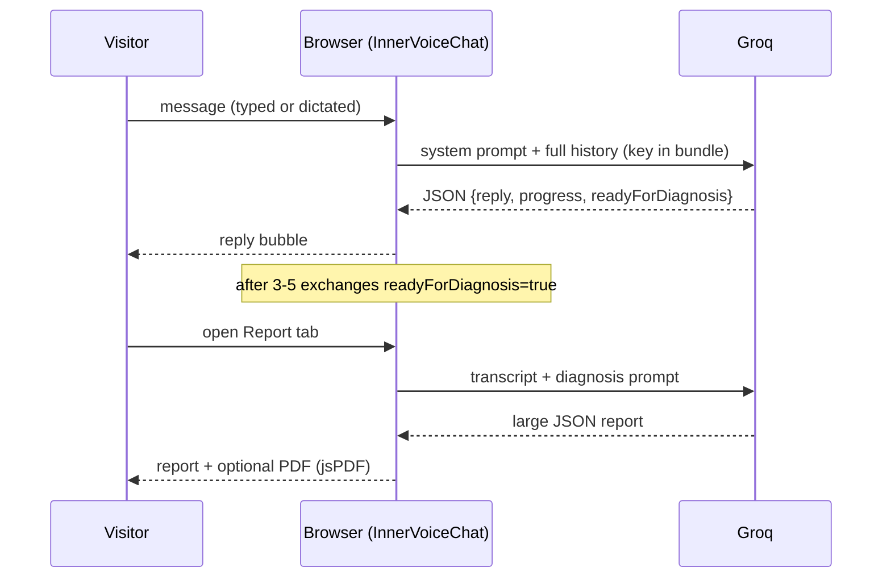

# User Flows and Use Cases

Back to [README](README.md). End-to-end journeys as the **code** implements them, with the point where each stops being real. Actors: **Visitor** (no login needed for anything except admin), **Registered user**, **Admin**, **System** (timers/webhooks). Feature IDs from [FEATURE_CATALOG.md](FEATURE_CATALOG.md); mechanics in [FEATURE_LOGIC_REFERENCE.md](FEATURE_LOGIC_REFERENCE.md). Mermaid blocks were written to be valid but **not rendered or syntax-tested**.

Key fact: **no user-facing feature requires login.** Accounts exist for admin access and (unused) profile data.

## UC-01 Register and verify (A1–A3)

```mermaid
flowchart TD
  R[/register step 1: details/] -->|POST /auth/register| S{email or phone already verified?}
  S -->|yes| E409[409 error toast]
  S -->|no| M[step 2: choose method]
  M -->|email| O[POST /auth/resend-otp REGISTER]
  O --> V[/verify-otp 6 digits/]
  V -->|POST /auth/verify-otp| T[tokens issued, user stored in Zustand]
  M -->|phone| W[MSG91 widget -> accessToken]
  W -->|POST /auth/verify-phone| T
  T --> H{profileCompleted?}
  H -->|false| G[/google-onboarding/]
  H -->|true, admin| A[/admin/]
  H -->|true| Home[/]
```
Actor: visitor. Preconditions: roles seeded. Failure paths: duplicate verified account (409), wrong/expired OTP (400), resend within 60 s (429), MSG91 mismatch (400). Gaps: email delivery failure is silent; OTP attempts unlimited. Acceptance: [TESTING_AND_ACCEPTANCE_CRITERIA.md](TESTING_AND_ACCEPTANCE_CRITERIA.md) A-series.

## UC-02 Login (A4, A7)
1. `/login` → `POST /auth/login`.
2. Full session → navigate to `from` or `getPostAuthPath(user)`: incomplete profile → `/google-onboarding`; admin → `/admin`; else `/`.
3. Unverified account → backend emails a LOGIN OTP and returns `{requiresVerification:true}`; `LoginPage` navigates to `/verify-otp` with state `{email, type:"LOGIN"}` (confirmed in `LoginPage.tsx`).
4. Thereafter every API call attaches the Bearer token; on 401 one shared refresh is attempted; failure logs the user out.

## UC-03 Google sign-in and profile completion (A5, A6)
Google button → ID token → `POST /auth/google` → existing user (by Google id or email, linking) or new user with `profileCompleted=false` → redirect to `/google-onboarding` → `POST /auth/complete-profile` (names, phone, state/country/city, DOB, age ≥ 10). Phone is not verified; completion is enforced only by the front-end redirect.

## UC-04 Forgot / reset password (A8)
`/forgot-password` → email → (Resend) link `FRONTEND_URL/reset-password?token=…` → `/reset-password` → new password (policy §BUSINESS_RULES 1) → login. Existing sessions stay valid.

## UC-05 Daily horoscope (B1)
Visitor opens `/horoscopes`, picks one of 12 signs → `GET /api/interpretation/horoscope/:sign` → LLM text (Hinglish). Different text on every request; no date in prompt. Error → "Failed to generate horoscope".

## UC-06 Explore a zodiac sign (B2)
`/zodiac` → `/zodiac/:sign`: static traits + a daily panel computed locally from a date-and-sign seed (stable within a calendar day on one device). Spin-wheel uses `Math.random`. Backend sign endpoints are not called.

## UC-07 Birth chart "Cosmic Identity" (B3)
Visitor enters first name + DOB (+ optional last name, time, place) → local sun sign / life path / pseudo-scores → 5.6 s animated wait while `POST /api/birthchart/analyze` runs → results page mixing LLM text and static dictionaries. API failure is silent. **Not an astrological chart** (no ascendant, moon, planets, houses; time ignored).

## UC-08 Compatibility (B5)
Two people's name + DOB → hash-derived scores (same input ⇒ same output) → 5.6 s wait → results and a chat box answering from canned keyword text. No server call.

## UC-09 Name Destiny report (B6, B6b)
`/name-destiny-report`: name + DOB → local numerology (instant) → `POST /api/name-analysis/narrative` for prose (mock text on any failure) → sections (core numbers, aura, timeline, heatmap, name variants ranked by local score, celebrities, lucky numbers). Unlocking "premium" is a client flag labelled "Demo unlock"; ₹499 is not charged. "Export PDF" is client-side jsPDF.

## UC-10 Tarot (B7)
Landing → mode: **Life Timeline** (question + 5 cards) or **Karma Mirror** (3 cards) → shuffle/choose → reveal → `POST /api/tarot/reading` → structured reading; any failure → static fallback reading. Nothing saved.

## UC-11 Palm reading (B8)
`/palm-reading`: camera or upload → quality check (hand detected, confidence ≥ 0.55, sharp, large enough) → overlay of template lines on landmarks → dashboard metrics and canned reading. Entirely in-browser; the image is not uploaded.

## UC-12 AI Guru consultation (C1, C2, C8)

Nothing is stored server-side; only a short title list is kept in `localStorage`. Refresh loses the conversation.

## UC-13 Voice consultation (C3)
Mic (Chrome/Edge) → transcript → topic regex guard (≥ 2 words; rejects programming/sports/recipes/etc.) → Groq reply (380 tokens) → Roman-script transliteration → language detection → `POST /api/tts` (≤ 500 chars) → Sarvam WAV → playback. On-demand translation of a reply via Groq.

## UC-14 Karma dashboard, journal, wisdom (C4–C6)
Profile saved locally → Groq returns score components → local composite with ticked daily actions → "Save today" persists up to 60 days locally. Journal: daily prompts, AI reflection, streak counter. Wisdom: situation → verse + meaning; save favourites. All data is per-browser.

## UC-15 Browse temples, offerings and shop (D1, D3, D5)
Public lists from the API (60 s client cache) → detail pages → quantity steppers and totals shown. **Dead end:** "Proceed to Book", "Proceed to Offer", "Add to Cart", "Buy Now" have no handlers. Use case "buy/book/offer" is **not implemented** (no order, payment, address, inventory model).

## UC-16 Watch a live darshan (E1–E4)
```mermaid
sequenceDiagram
  participant Y as YouTube
  participant H as WebSub hub
  participant S as Backend
  participant DB as PostgreSQL
  participant C as Browser
  S->>H: subscribe channel feed (callback /api/darshan/websub/callback)
  H-->>S: GET challenge, S echoes it
  Y->>H: new video published
  H->>S: POST atom/xml (unsigned)
  S-->>H: 204
  S->>Y: videos.list (snippet,status)
  S->>DB: markLive / markOffline
  S-->>C: SSE event (DarshanChannelDTO)
  C->>C: patch React Query cache; show player if isLive and videoId
  loop every 120 s
    S->>Y: re-check currently-live videos
    S->>DB: touchLastChecked or markOffline
  end
```
Visitor opens `/avatar-live/darshan`, sees temples, opens `/…/:slug`; the embedded IFrame appears only while the backend says live. Donate, prayer wall, reminders, viewer counts and "family events" are decorative.

## UC-17 Admin manages catalogue (D7–D11)
Admin logs in → `/admin` → Puja/Chadhawa/Shop screens → forms validated by Joi server-side → images to Cloudinary → public pages reflect changes after the 60 s client cache.

## UC-18 System: Darshan lifecycle (E2, E3)
At boot: subscribe all channels with IDs, renew every 3 days, poll every 120 s for live ones. Missed events (process down, stream live before subscribe) are not reconciled.

## UC-19 Contact and newsletter (F1, F2)
Both show a success state without sending anything.

## Use cases the product copy implies but the code does not support
Booking a puja and receiving confirmation/certificate/prasad; paying; donating; viewing order history; real Kundali/dasha/transit prediction; saved readings across devices; push/WhatsApp reminders; moderated prayer wall; account deletion. Status and decisions: [PRODUCT_DECISIONS_AND_OPEN_QUESTIONS.md](PRODUCT_DECISIONS_AND_OPEN_QUESTIONS.md), [RESTART_ROADMAP.md](RESTART_ROADMAP.md).
